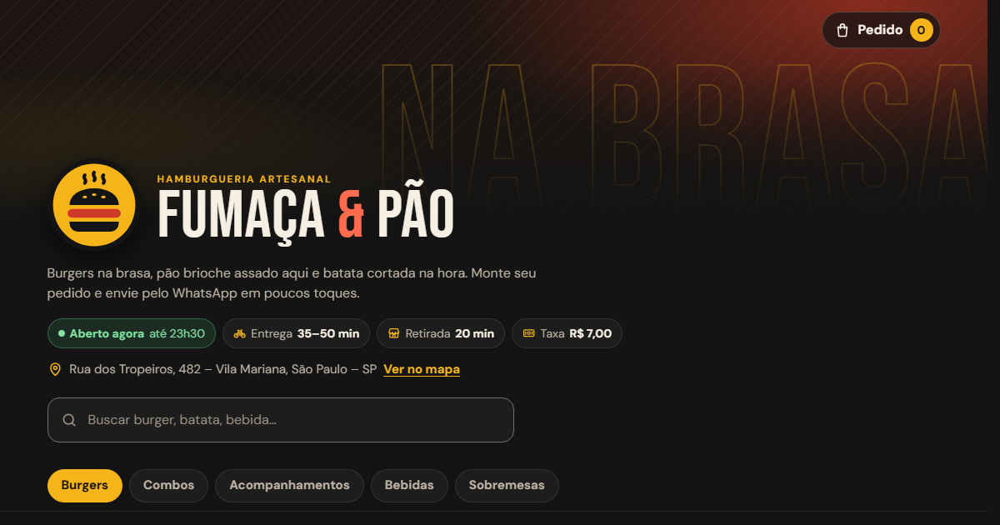

# Fumaça & Pão Hamburgueria · Cardápio digital

Cardápio digital para hamburgueria, com carrinho, personalização de lanches e pedido enviado pronto pelo WhatsApp. Feito em HTML, CSS e JavaScript puros.



> Tire um print da página aberta no navegador (de preferência com o carrinho visível) e salve na raiz do projeto como `preview.png` para a imagem aparecer aqui e na prévia de links.

## Funcionalidades

- **Status de funcionamento em tempo real**: o selo "Aberto agora / Fechado" é calculado pelo horário configurado e pelo fuso da loja, inclusive para turnos que passam da meia-noite. Avisa quando está "Fechando em breve" e diz quando abre de novo.
- **Abas de categoria fixas no topo**: um toque leva à seção, e a aba ativa acompanha a rolagem (IntersectionObserver).
- **Busca instantânea** por nome, ingrediente, categoria ou etiqueta, sem diferenciar acentos ("pao" acha "pão"), com estado vazio.
- **18 itens de exemplo** com etiquetas ("mais pedido", "novo", "vegetariano", "picante"...) e preço "de/por" nos combos.
- **Tela de detalhe do item** com quantidade, adicionais pagos (bacon, cheddar, ovo) e campo de observação ("sem cebola").
- **Carrinho** com quantidade, remoção, adicionais e observações por item, subtotal e barra flutuante com total. O carrinho fica salvo no navegador (localStorage) e sincroniza entre abas.
- **Finalização em etapas** dentro do próprio carrinho: nome, entrega ou retirada, endereço (só para entrega), forma de pagamento (Pix, cartão, dinheiro com troco), taxa de entrega e total. A validação explica em português o que falta.
- **Pedido pelo WhatsApp**: monta uma mensagem organizada (itens, adicionais, observações, totais, endereço e pagamento) e abre o `wa.me`. Fora do horário, o pedido pode ser enviado com aviso de que será respondido quando a loja abrir.
- **Lembra os dados do cliente** (nome e endereço) para o próximo pedido no mesmo aparelho, com um botão "Apagar meus dados" para quem usa um aparelho compartilhado.
- **Acessível**: navegação completa por teclado, foco preso nos painéis, Esc para fechar, foco devolvido ao botão de origem, anúncios para leitor de tela, contraste AA e respeito a `prefers-reduced-motion`.
- **Mobile first**: pensado para o celular (painéis sobem de baixo), com layout próprio para desktop (gaveta lateral e modal central).
- **SEO**: título, descrição, Open Graph e favicon em SVG.

## Tecnologias

- HTML5 semântico
- CSS3 (variáveis CSS, grid, flexbox, `:has()`, `dvh`, media queries)
- JavaScript puro (sem frameworks, sem build, sem dependências)
- Google Fonts: Bebas Neue e DM Sans

## Como rodar

Não precisa instalar nada.

1. Baixe ou clone o repositório.
2. Dê dois cliques no `index.html`.

Se preferir servir por um servidor local (útil para testar no celular pela rede):

```bash
npx serve .
```

## Como personalizar

### Nome, WhatsApp, taxa e horários

Tudo fica no objeto `CONFIG`, no topo de [`js/script.js`](js/script.js):

```js
const CONFIG = {
  nome: "Fumaça & Pão",
  whatsapp: "5511900000000", // DDI + DDD + número, só dígitos
  telefone: "(11) 90000-0000",
  endereco: "Rua dos Tropeiros, 482 – Vila Mariana, São Paulo – SP",
  taxaEntrega: 7.0, // 0 = entrega grátis
  tempoEntrega: "35–50 min",
  tempoRetirada: "20 min",
  fusoHorario: "America/Sao_Paulo",
  horario: {
    0: { abre: "18:00", fecha: "23:30" }, // domingo
    1: null, // segunda: fechado
    // ...
    5: { abre: "18:00", fecha: "00:30" }, // sexta, fecha depois da meia-noite
  },
  redes: { instagram: "https://instagram.com/sua-loja", facebook: "" },
};
```

- `whatsapp`: número que recebe os pedidos, no formato internacional sem `+`, espaços ou traços.
- `horario`: dias de 0 (domingo) a 6 (sábado). Use `null` para dia fechado. A lista de horários do rodapé é gerada a partir daqui.
- `redes`: deixe uma rede vazia (`""`) para esconder o ícone dela.

O nome também aparece no `<title>`, nas meta tags e no texto fixo do `index.html`. Troque lá também.

### Cores e fontes

Todas as cores, fontes e medidas estão em `:root`, no começo de [`css/style.css`](css/style.css). Os principais:

| Variável | Uso |
| --- | --- |
| `--cor-fundo` | fundo da página |
| `--cor-primaria` | amarelo mostarda (botões, preços, aba ativa) |
| `--cor-destaque` | vermelho tomate (detalhes e avisos) |
| `--cor-texto` | texto principal |
| `--fonte-titulo` / `--fonte-texto` | fontes dos títulos e do texto |

Ao trocar as fontes, atualize também o `<link>` do Google Fonts no `index.html`.

### Itens do cardápio

O cardápio inteiro está em [`js/data.js`](js/data.js), em três listas:

- `CATEGORIAS`: as seções e abas, na ordem em que aparecem.
- `EXTRAS`: os adicionais pagos (nome e preço).
- `CARDAPIO`: os itens.

Para **adicionar um item**, copie um bloco e ajuste:

```js
{
  id: "x-salada",            // único, sem espaços nem acentos
  categoria: "burgers",      // id de uma categoria
  nome: "X-Salada",
  descricao: "Blend de 160 g, queijo, alface, tomate e maionese.",
  preco: 29.9,               // em reais, com ponto
  precoDe: 34.9,             // opcional: preço riscado
  emoji: "🍔",
  detalhe: "🥬",             // opcional: emoji pequeno no canto
  imagem: "img/x-salada.jpg", // opcional: foto real no lugar do emoji
  tags: ["novo"],
  extras: ["bacon", "cheddar", "ovo"], // opcional: adicionais aceitos
},
```

Para **remover** um item, apague o bloco. Para **mudar preço**, altere `preco`. Carrinhos já salvos nos navegadores dos clientes passam a usar o preço novo automaticamente, e itens removidos somem do carrinho sozinhos.

As fotos de exemplo dos itens vêm do [Unsplash](https://unsplash.com), de uso gratuito ([licença](https://unsplash.com/license)). Para usar **as fotos dos seus lanches**, crie uma pasta `img/`, coloque as fotos (uns 800 × 600 px) e troque o campo `imagem` de cada item. Se uma foto não carregar, o emoji do item aparece no lugar.

## Como publicar grátis no GitHub Pages

1. Crie um repositório no GitHub (por exemplo, `cardapio-hamburgueria`) e envie os arquivos.
2. No repositório, vá em **Settings → Pages**.
3. Em **Build and deployment**, escolha **Deploy from a branch**, selecione a branch `main` e a pasta `/ (root)`. Salve.
4. Em alguns minutos o site fica disponível em `https://seu-usuario.github.io/cardapio-hamburgueria/`.
5. Atualize as URLs de `og:url` e `og:image` no `index.html` com esse endereço, para a prévia do link aparecer certinha no WhatsApp e nas redes.

## Ideias para evoluir

1. **Taxa por bairro**: trocar `taxaEntrega` por uma tabela `{ bairro: taxa }` e transformar o campo de bairro em uma lista, calculando a taxa conforme a escolha.
2. **Pedido mínimo e entrega grátis**: adicionar `pedidoMinimo` e `entregaGratisAcimaDe` no `CONFIG`, bloquear o botão de continuar abaixo do mínimo e mostrar quanto falta para ganhar frete grátis.
3. **Cupom de desconto**: um campo na etapa de dados que valida códigos definidos em `data.js` (valor fixo ou porcentagem) e mostra o desconto no resumo e na mensagem.
4. **Opções obrigatórias**: permitir grupos como "ponto da carne" ou "sabor do refrigerante" com escolha única obrigatória, no lugar de pedir isso na observação.
5. **Cardápio editável sem mexer no código**: ler os itens de uma planilha do Google Sheets publicada como CSV, para o dono da loja atualizar preços e esgotar itens pelo celular.
